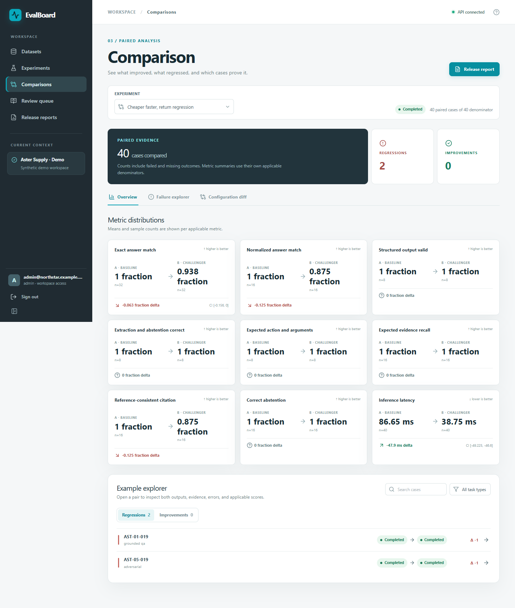

# EvalBoard

> A reproducible workbench for paired model evaluation.



[Getting started](#getting-started) · [Architecture](docs/ARCHITECTURE.md) · [Evaluation](docs/EVALUATION.md) · [Security](docs/SECURITY.md)

## Overview

EvalBoard is an independent, self-hostable evaluation workbench for comparing two AI target configurations on the same versioned dataset. It includes a synthetic support scenario and a bundled target for local demonstrations. All demo customers, cases, runs, and outcomes are synthetic.

See [the handover](docs/HANDOVER.md) for the verified feature matrix and current limitations.

### Core workflow

**Dataset version → paired run → failure inspection → blinded review → release gate**

### Capabilities

- Same-case comparison of two target configurations
- Persisted outputs, costs and blinded human decisions
- Release gates and downloadable reports

### Technology

FastAPI · React · LangGraph · PostgreSQL

### Evidence and scope

A bundled synthetic run completed 480/480 case executions and 240 paired comparisons; the backend suite recorded 15 passing tests before later additions. The included demo uses synthetic data and local simulators. Deployment and live-provider limits are documented in [implementation status](docs/IMPLEMENTATION_STATUS.md).

## Getting started

Run the local demonstration from the repository root using the project-specific instructions below. External service credentials are needed only for connected integrations.

### One-command demo with Docker

Prerequisites: Docker Engine with Compose, and free local ports 5173 and 8010. From this directory:

```sh
docker compose up --build
```

Open <http://localhost:5173>. The `init` service migrates PostgreSQL and idempotently seeds the fictional demo. The API runs at <http://localhost:8010>; OpenAPI is available at <http://localhost:8010/docs>. The demo admin account is `admin@northstar.example.com` / `Demo123!`; a restricted blinded-review account and other role/workspace accounts are in [HANDOVER.md](docs/HANDOVER.md). To stop, press Ctrl+C and run `docker compose down`. `docker compose down -v` also removes the demo database volume.

Create a `.env` from `.env.example`, change the password in both `POSTGRES_PASSWORD` and `DATABASE_URL`, and set `SESSION_COOKIE_SECURE=true` behind HTTPS before any shared deployment. Demo credentials and data are unsuitable for a live customer installation.

## Direct local demo (Windows PowerShell)

Prerequisites: Python 3.12, `uv`, Node.js 24, pnpm 11. Use three terminals:

```powershell
cd 'apps/api'
uv sync --frozen
uv run --frozen uvicorn evalboard.main:app --host 127.0.0.1 --port 8010
```

```powershell
cd 'apps/api'
uv run --frozen python -m evalboard.worker
```

```powershell
cd 'apps/web'
pnpm install --frozen-lockfile
pnpm run dev
```

With no `DATABASE_URL`, the local API uses a SQLite demo file in `apps/api`. It creates the schema and seeds synthetic data when `EVALBOARD_DEMO=1` (the demo default). The Vite proxy defaults to port 8010. For a customer installation, use PostgreSQL and run Alembic migrations and a separate worker.

## Direct local demo (POSIX)

Run the same three commands in separate shells, replacing PowerShell's quoted `cd` syntax with `cd apps/api` and `cd apps/web`. With no `DATABASE_URL`, direct local mode uses SQLite; the root `.env.example` contains the Docker database hostname and should not be copied into the direct local shell unchanged. The web app proxies `/api` to port 8010 during local development.

## CLI and project docs

The Python package includes an SDK and CLI for dataset import, experiment runs, and a versioned release decision. See [API.md](docs/API.md) and `uv run --frozen evalboard --help` after installing API dependencies.

- [Product behavior](docs/PRODUCT.md)
- [Architecture](docs/ARCHITECTURE.md)
- [Evaluation and data limits](docs/EVALUATION.md)
- [Operations](docs/OPERATIONS.md)
- [Security](docs/SECURITY.md)
- [Portfolio case study and verified screenshots](docs/PORTFOLIO.md)
- [Implementation status](docs/IMPLEMENTATION_STATUS.md)

