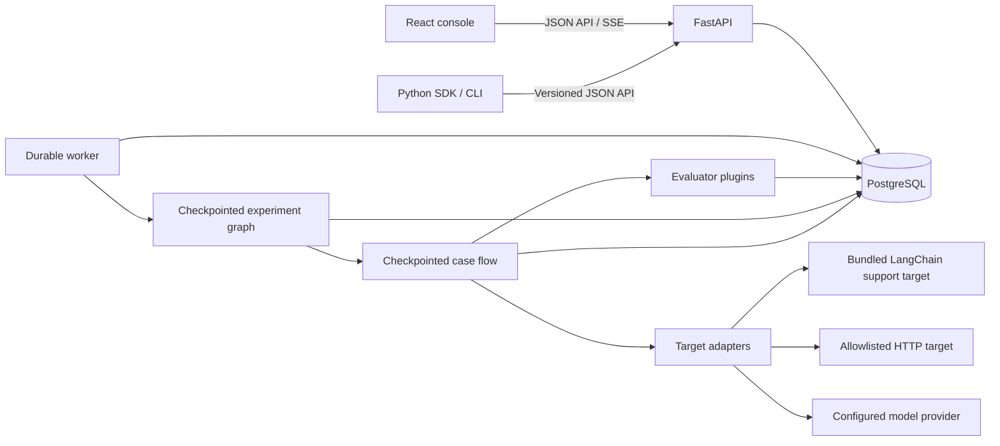
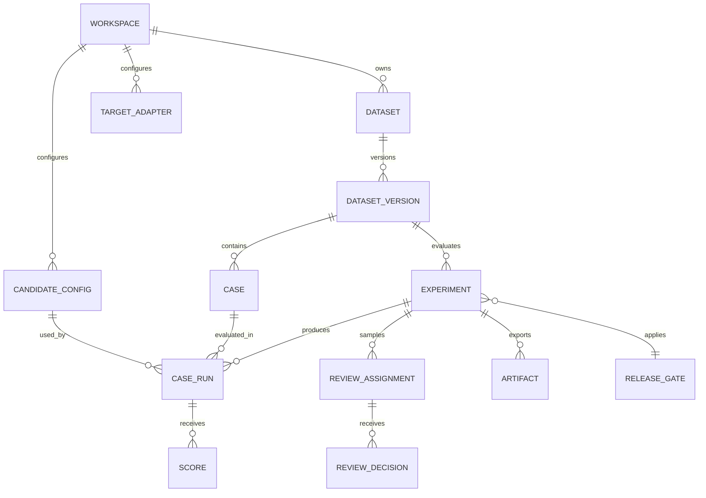

# Architecture

EvalBoard is a modular monolith. FastAPI owns validation, authorization, and application use cases. PostgreSQL holds versioned cases, experiments, target outputs, metrics, reviews, and artifacts. A separate worker claims durable jobs and executes the bounded evaluation flow. React reads typed API responses; SSE carries observable run events.

The experiment LangGraph schedules bounded batches, executes checkpointed case subgraphs, aggregates paired results, creates blinded review work, interrupts for unresolved human review, and finalizes the release decision after a durable resume. The case graph validates and records target output before scoring so rescoring cannot silently rerun inference. The SQL job queue owns leases and abandoned-work recovery; the graph checkpointer owns workflow state. A server-generated experiment thread ID is scoped through the job and workspace before a review decision can trigger resumption. PostgreSQL is the connected checkpointer; the local SQLite checkpointer supports the single-machine demo.

## Logical data relationships

Case-run uniqueness is based on experiment, case, candidate, and repetition. Workspace checks apply to every read, stream, export, and resume operation. A stored ID is never an authorization token.

## Local and connected modes

In DEMO, seeded data and simulator responses are synthetic. SQLite can support a single-machine direct local demo. In CONNECTED, PostgreSQL is the deployment database, credentials and model IDs are server configuration, and provider errors remain visible. LangSmith tracing is optional and disabled unless explicitly configured.
